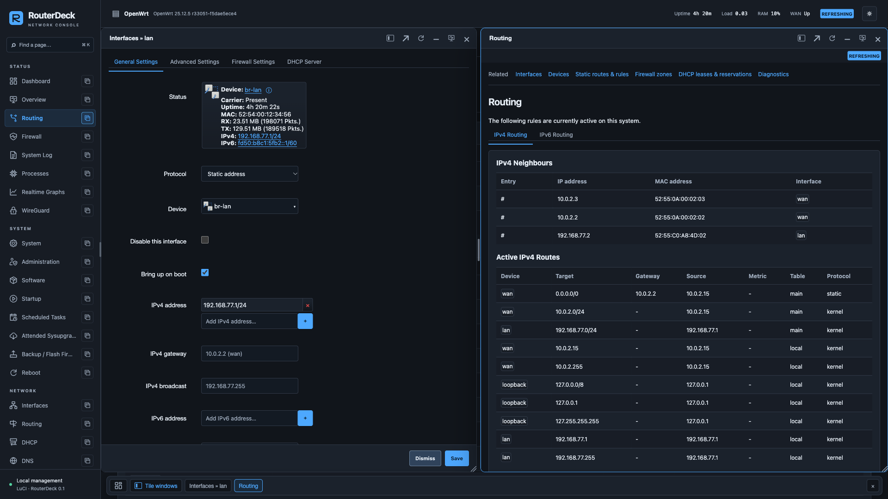

# RouterDeck

A compact dark and light theme for **OpenWrt LuCI**, inspired by the information
density of desktop network tools. Real LuCI forms, real package installation,
and a separate live dashboard. The theme uses plain JavaScript and CSS.

[Русский](README.ru.md) · [Installation](docs/installation.md) · [Navigation and windows](docs/navigation.md) · [Development](docs/development.md) · [Compatibility](docs/compatibility.md)



This README describes **current `main`**, including changes after the published
**v0.1.0 prerelease**. The integrated windows below are not in that release's
downloadable packages. Build current source to try them; see the
[changelog](CHANGELOG.md) and [v0.1.0 release notes](docs/releases/v0.1.0.md).

## Current features

- **`luci-theme-routerdeck`**: dark/light switching without reloading, persistent
  browser preference, searchable navigation generated from the permitted LuCI
  menu, compact forms/tables/dialogs, a resizable sidebar and keyboard navigation.
  Object links and a button beside each menu page open windows with automatic
  arrangement, edge snapping and persistent layouts.
- **`luci-app-routerdeck`**, optional: uptime, load average, RAM, storage, WAN
  address and sampled traffic, connection count, logical interfaces, DHCP leases,
  and basic WireGuard interface state using existing ubus/rpcd services.
- **`luci-app-routerdeck-workspace`**, compatibility only: redirects old Workspace
  bookmarks. Windows are now built into the theme, without a separate menu page.
- **`routerdeck-console`**, experimental and separate from LuCI: a windowed
  console at `/routerdeck/`, modelled on desktop router tools, that talks to rpcd
  over `/ubus`. Quick Set, WiFi, interfaces (Ethernet, VLAN, WireGuard), bridges,
  PPP, IPv4 and IPv6 addresses, routes and policy rules, firewall with address
  lists, DHCP and DHCPv6, DNS, UPnP, dynamic DNS, SQM queues, services, the System
  menu and the log are live object lists; Ping, Traceroute, Torch, Bandwidth Test,
  IP Scan, Netwatch, Wake on LAN and traffic graphs are tools; changes apply at
  once with Undo/Redo and Safe Mode rollback. New Terminal is a RouterOS-style command line over the
  same objects; New Shell uses ttyd. See [RouterDeck Console](docs/console.md). Its bundle
  includes Preact (MIT).
- Bootstrap remains installed. Installing RouterDeck registers it without
  changing the current design. Removing the selected theme restores Bootstrap.

This is an **MVP / preview release**, not a declaration of universal compatibility.
Windows require editing one form at a time. CPU utilization,
temperature sensors, WireGuard peer handshakes and client presence detection are
not implemented; the dashboard does not invent these values.

## Using windows

- Click a menu **label** to navigate normally; click the **window button** beside
  it to open that page alongside the current one.
- Click an interface, device or firewall zone to open its native editor. An
  adjacent information button opens runtime details. Editors fill their window,
  with a single title and Save/Dismiss always accessible below the scrolling form.
- New windows automatically share the work area. Drag a title to an edge or
  corner to snap it; drag the divider between two columns to change their widths.
- The sidebar stays accessible even with maximized windows. Drag its right edge
  to resize it; double-click to restore the default width.
- Edit and apply one form at a time. Saving stages LuCI changes; applying them
  requires the normal **Save & Apply** flow.

See [Navigation and windows](docs/navigation.md) for shortcuts, supported object
links, layout restoration and handling unsaved changes.

## Compatibility

| Firmware | Package | Validation |
| --- | --- | --- |
| OpenWrt 25.12.5, armsr/armv8 | `.apk`, noarch | Release and current window UI in QEMU |
| OpenWrt 24.10.8, armsr/armv8 | `.ipk`, all | v0.1.0 in QEMU; latest window changes not revalidated |
| FriendlyWrt, NanoPi R3S-LTS | Not certified | Hardware/firmware validation pending |

See [the test report](docs/testing.md) for exactly what was exercised. These are
browser/UI and configuration lifecycle checks; they do not establish hardware
acceleration, PPPoE negotiation, VPN connectivity or firmware flashing support
on a physical device.

## Install

For the published v0.1.0 prerelease, download packages for your firmware's package manager from
[GitHub Releases](https://github.com/maccmd/routerdeck/releases). Verify the
matching `SHA256SUMS-apk` or `SHA256SUMS-ipk`, then copy the files to `/tmp` on your
router. Keep a working SSH connection while changing themes.

```sh
# OpenWrt 25.12: install LuCI if it is not installed yet
apk update
apk add luci luci-theme-bootstrap
apk add --allow-untrusted /tmp/luci-theme-routerdeck-0.1.0-r1.apk
# Optional dashboard:
apk add --allow-untrusted /tmp/luci-app-routerdeck-0.1.0-r1.apk
# v0.1.0 only: optional experimental Workspace page
# In current source this package only redirects old Workspace bookmarks.
apk add --allow-untrusted /tmp/luci-app-routerdeck-workspace-0.1.0-r1.apk
```

Select **System → System → Language and Style → Design → RouterDeck**, then
**Save & Apply**. Dashboard appears under Status when the optional package is
installed. Root's existing password and the usual LuCI session are used.

For the current window UI, [build the source packages](docs/development.md#checks-and-builds)
and follow the [installation guide](docs/installation.md). For OpenWrt 24.10 use
`opkg update`, `opkg install luci luci-theme-bootstrap`,
then `opkg install /tmp/luci-theme-routerdeck_0.1.0-r1_all.ipk` and optionally
`opkg install /tmp/luci-app-routerdeck_0.1.0-r1_all.ipk`.

## Restore / uninstall

```sh
uci set luci.main.mediaurlbase='/luci-static/bootstrap'
uci commit luci
# 25.12:
apk del luci-app-routerdeck-workspace luci-app-routerdeck luci-theme-routerdeck
# 24.10: opkg remove luci-app-routerdeck-workspace luci-app-routerdeck luci-theme-routerdeck
```

Omit optional package names that were not installed. Refresh the browser.
See [recovery instructions](docs/installation.md#recovery) if a stale page remains.

## Develop on macOS

Node.js 22+, Python 3, QEMU and a running Docker installation are used for the
complete workflow. The local preview only needs Node.js.

```sh
npm ci
npm run dev                     # http://127.0.0.1:5173 — mock data
npx playwright install chromium webkit
./scripts/test.sh
./scripts/package.sh 25.12.5     # official SDK → dist/packages/25.12/*.apk
./scripts/package.sh 24.10.8     # official SDK → dist/packages/24.10/*.ipk
```

The preview is visibly marked as simulated and never talks to a router. Build
output from `npm run build` is a static preview, **not** an OpenWrt package.

[VM setup](docs/development.md#openwrt-vm) binds HTTP and SSH to loopback, uses QEMU
user-mode networking and changes no host network interfaces. Real VM tests:

```sh
npm run test:vm
npx playwright test --config playwright.lifecycle.config.mjs
```

GitHub Actions runs preview tests and builds all three packages from checksum-pinned
official SDKs. A matching `v*` tag publishes a GitHub prerelease and checksums.
VM checks are a separate release gate run locally; CI does not pretend to run them.

## License

[Apache-2.0](LICENSE). See [NOTICE](NOTICE) for LuCI integration attribution.
The design uses original artwork and system fonts; no MikroTik assets are bundled.
