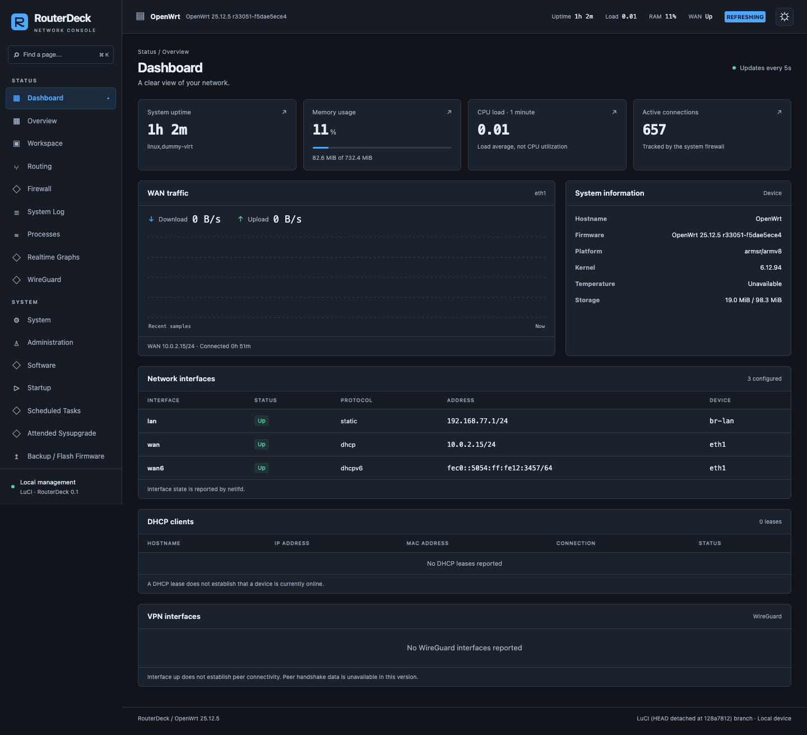

# RouterDeck

Компактная тёмная и светлая тема для **OpenWrt LuCI** с отдельной панелью
мониторинга. Сохраняет штатные формы LuCI, управление доступом и Save & Apply.
На роутере работают обычные JavaScript и CSS, без React и других фреймворков.

[English](README.md) · [Установка](docs/installation.md) · [Разработка](docs/development.md) · [Совместимость](docs/compatibility.md)



## Возможности MVP

- Пакет **`luci-theme-routerdeck`**: две цветовые темы, мгновенное переключение,
  сохранение выбора в браузере, поиск по меню, мобильная навигация, оформление
  таблиц, форм и модальных окон. Меню строится по доступным страницам LuCI.
- Необязательный **`luci-app-routerdeck`**: uptime, средняя нагрузка, RAM,
  накопитель, WAN и его трафик, число соединений, интерфейсы, DHCP-аренды и
  базовое состояние интерфейсов WireGuard. Данные поступают из ubus/rpcd.
- Необязательный **`luci-app-routerdeck-workspace`**: окна со штатными страницами
  LuCI, перемещение, размер, сворачивание, сохранение расположения и защита от
  случайного закрытия изменённой формы.
- Bootstrap остаётся установленным. Установка RouterDeck не меняет выбранную
  тему; при удалении активной темы выполняется возврат на Bootstrap.

Версия 0.1 — **MVP, предварительный выпуск**. Оконный режим экспериментальный:
редактируйте и применяйте одну форму за раз. Процент загрузки CPU, температура, рукопожатия WireGuard
и определение присутствия клиентов пока не реализованы. Недоступные значения
помечены явно; наличие DHCP-аренды не выдаётся за статус «онлайн».

## Совместимость

| Система | Формат | Проверка |
| --- | --- | --- |
| OpenWrt 25.12.5, armsr/armv8 | `.apk` | QEMU на Apple Silicon |
| OpenWrt 24.10.8, armsr/armv8 | `.ipk` | QEMU на Apple Silicon |
| FriendlyWrt / NanoPi R3S-LTS | Не подтверждена | Нужна проверка конкретной прошивки и устройства |

Подробные границы проверки перечислены в [отчёте](docs/testing.md).

## Установка

Скачайте пакеты своего формата из [Releases](https://github.com/maccmd/routerdeck/releases),
сверьте контрольные суммы и перенесите файлы в `/tmp` роутера.

```sh
# OpenWrt 25.12
apk update
apk add luci luci-theme-bootstrap
apk add --allow-untrusted /tmp/luci-theme-routerdeck-0.1.0-r1.apk
# Необязательная панель мониторинга
apk add --allow-untrusted /tmp/luci-app-routerdeck-0.1.0-r1.apk
# Optional experimental workspace / Необязательный оконный режим:
apk add --allow-untrusted /tmp/luci-app-routerdeck-workspace-0.1.0-r1.apk
```

Для 24.10 используйте `opkg install` и файлы
`luci-theme-routerdeck_0.1.0-r1_all.ipk`,
`luci-app-routerdeck_0.1.0-r1_all.ipk`.

Выберите **System → System → Language and Style → Design → RouterDeck** и
нажмите **Save & Apply**. Авторизация остаётся штатной. Сохраните доступ по SSH
на время смены темы.

## Возврат и удаление

```sh
uci set luci.main.mediaurlbase='/luci-static/bootstrap'
uci commit luci
apk del luci-app-routerdeck-workspace luci-app-routerdeck luci-theme-routerdeck
# В 24.10: opkg remove luci-app-routerdeck-workspace luci-app-routerdeck luci-theme-routerdeck
```

Уберите из команды имена расширений, которые не устанавливались. Обновите страницу.

## Локальная разработка

```sh
npm ci
npm run dev                 # http://127.0.0.1:5173
npx playwright install chromium webkit
./scripts/test.sh
./scripts/package.sh 25.12.5
./scripts/package.sh 24.10.8
```

Preview работает только с тестовыми данными и явно это показывает. Настоящая
интеграция проверяется отдельно в [OpenWrt VM](docs/development.md#openwrt-vm).
Доступ к VM открыт на `127.0.0.1`; сетевые настройки macOS менять не требуется.

Лицензия — [Apache-2.0](LICENSE), сведения об использованной интеграции LuCI —
в [NOTICE](NOTICE). Проект не связан с MikroTik и не распространяет её графические ресурсы.
