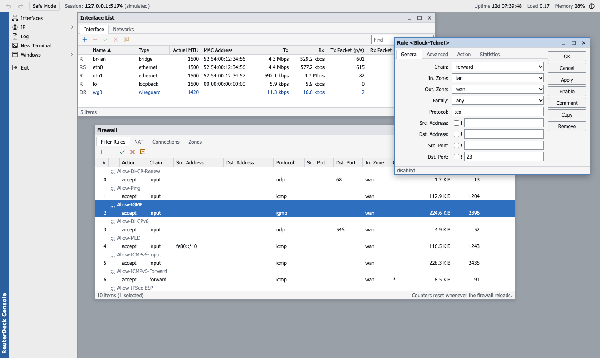

# RouterDeck Console

RouterDeck Console is a separate, experimental management interface for
OpenWrt, modelled on the way desktop router tools such as MikroTik WinBox
work. It is not a LuCI theme and does not need LuCI. It talks to rpcd over
uhttpd's `/ubus` JSON-RPC endpoint and edits UCI through its own rpcd plugin.
RouterDeck is not affiliated with MikroTik and uses none of its code or artwork.

[Russian plan and status](console-plan.ru.md) · [Development](development.md) · [Architecture](architecture.md#routerdeck-console)



Dark theme: [screenshot](screenshots/console-dark.png). Both show the simulated router of the development preview.

## What it does

- **Windows instead of pages.** A menu item opens a window inside the work
  area. Windows open cascaded where that kind of window was last placed and
  overlap; nothing is rearranged automatically. *Windows ▸ Cascade / Tile /
  Minimize All / Close All* arrange them on request. The open windows and
  their positions come back after a reload or the next login.
- **Object lists.** Each list has a `+ − ✓ ✗` and comment toolbar, Find, a
  flags column, `;;; comment` lines above commented objects, sorting, a column
  chooser (right-click a column header), multi-select, a context menu and a
  status bar with `N items (M selected)`. Data refreshes every one to five
  seconds without losing selection or scroll position.
- **Object windows.** Double-click or Enter opens an object: fields on the
  left, **OK / Cancel / Apply / Disable / Comment / Copy / Remove** on the
  right, a status bar below. Fields you have not touched keep following live
  data; the status bar says when the object changed on the router while you
  were editing it.
- **Changes apply at once.** OK, Apply, `✓ ✗`, Remove and drag-and-drop write
  the change, reload the affected service and record it. There is no
  separate *Save & Apply* step.
- **Undo / Redo** (toolbar, Ctrl+Z / Ctrl+Shift+Z) step through the last 100
  changes. A change made outside the console (LuCI, the CLI) blocks undoing
  across it instead of overwriting it.
- **Safe Mode** (toolbar). While it is on, the router undoes every change made
  since you switched it on if this console stops answering for 120 seconds —
  for example after a change cut your own connection. Clicking it again keeps
  the changes; *Undo Safe Mode changes* restores the snapshot immediately.
  After 100 changes Safe Mode ends and keeps them.
- **Terminal.** *New Terminal* (Alt+T) embeds the router's shell through
  [ttyd](https://github.com/tsl0922/ttyd), which asks for its own login.

## Windows and OpenWrt objects

| Window | OpenWrt source | Flags | Notes |
| --- | --- | --- | --- |
| Interfaces ▸ Interface | Linux network devices (`luci-rpc getNetworkDevices`), `network.device` sections | R running, S bridge port, D dynamic, I not present | Live Tx/Rx bit and packet rates. Bridges and VLANs can be added; MTU and MAC edited |
| Interfaces ▸ Networks | `network.interface` sections and runtime state | R running, X disabled, D dynamic | OpenWrt-specific: protocol, device, firewall zone, PPPoE/DHCP options |
| IP ▸ Addresses | `ipaddr` of static networks; addresses obtained by DHCP/PPP | D dynamic, I network down | A single address cannot be disabled or commented in UCI |
| IP ▸ Routes | kernel routes (`ip -j route`, busybox fallback) and `route` sections | X, D, A active, C connect, S static | Filter by routing table; static routes are matched to kernel routes |
| IP ▸ Firewall ▸ Filter Rules | `rule` sections in order, nftables counters | X disabled | Drag to reorder; comment is the rule `name`; counters reset on every fw4 reload |
| IP ▸ Firewall ▸ NAT | `redirect` (dst-nat), `nat` (src-nat, masquerade), zone masquerading | X, D zone masquerading | New src-nat rules are `nat` sections |
| IP ▸ Firewall ▸ Connections | `/proc/net/nf_conntrack` | A assured, U unreplied | First 2048 entries |
| IP ▸ Firewall ▸ Zones | `zone` and `forwarding` sections | X disabled | A zone used by rules cannot be removed |
| Bridge ▸ Bridge | `device` sections of type bridge | R running, D dynamic, I not created yet | OpenWrt creates a bridge only once a network uses it; STP, IGMP snooping, MTU, MAC |
| Bridge ▸ Ports | the bridge's `ports` list; members added at runtime | R running, I missing, D dynamic | PVID and tagged VLANs per port; removing a port also removes it from the bridge's VLANs |
| Bridge ▸ VLANs | `bridge-vlan` sections | I not active | Tagged, untagged and PVID ports; one PVID per port; the first VLAN turns on VLAN filtering |
| IPv6 ▸ Addresses | static `ip6addr`, addresses assigned from a prefix (`ip6assign`), DHCPv6/SLAAC, link-local | D dynamic, G global, L link-local, I not on the network | *From Pool* shows the assigned prefix; *Advertise* whether router advertisements are on |
| IPv6 ▸ Routes | kernel IPv6 routes and `route6` sections | X, D, A, C, S | Source-specific routes show their source prefix |
| IP ▸ DHCP Server ▸ DHCP | `dhcp` sections | X ignored | Address pool from the network's first address |
| IP ▸ DHCP Server ▸ Leases | active DHCPv4 leases and `host` sections | X disabled, D dynamic | *Make Static* reserves a dynamic lease. A lease does not prove a client is online |
| Log | logd (`log read`), `logread` fallback | — | Last 1000 lines, follows new entries |

Comments on routes, networks, devices, DHCP servers and static leases are
stored as `option comment`, which netifd and dnsmasq ignore.

## Keyboard

| Keys | Action |
| --- | --- |
| Insert / Delete | Add / remove in a list |
| Ctrl+E / Ctrl+D | Enable / disable the selection |
| Ctrl+M | Comment the selection |
| Ctrl+F | Find in the list |
| Enter, double-click | Open the selected object |
| Arrows, Shift+arrows, Ctrl+A | Move and extend the selection |
| Esc, F4 | Close the window |
| F6 / Shift+F6 | Next / previous window |
| Alt+T | New terminal |
| Ctrl+Z / Ctrl+Shift+Z | Undo / redo |
| Window title + arrows / Shift+arrows | Move / resize the window |

## Installation

Build the packages (see [Development](development.md#checks-and-builds)) and
install `routerdeck-console` on the router:

```sh
# OpenWrt 25.12
apk add --allow-untrusted /tmp/routerdeck-console-0.1.0-r1.apk
# OpenWrt 24.10
opkg install /tmp/routerdeck-console_0.1.0-r1_all.ipk
```

Open `http://<router>/routerdeck/` and log in with a router account (root by
default). The package depends on rpcd, its ucode and luci-rpc modules, the
ucode fs/ubus/uci modules, uhttpd with `/ubus`, and firewall4; standard
OpenWrt images with LuCI already have all of them. For the terminal, install
ttyd (`apk add ttyd` or `opkg install ttyd`).

Removing the package (`apk del routerdeck-console` / `opkg remove
routerdeck-console`) stops the Safe Mode watchdog, deletes the runtime state
in `/var/run/routerdeck` and leaves `/etc/config` as it is.

## How changes are made

Every action is one call to the `routerdeck` rpcd object (`apply`, `undo`,
`redo`, `safemode`). The plugin:

1. refuses to run while LuCI is waiting to confirm an *apply with rollback*,
   so the two rollbacks cannot overwrite each other;
2. stages the operations in a private UCI delta directory and commits only
   them, never other sessions' or the CLI's pending changes;
3. runs `fw4 check` before and after firewall changes and rejects a change that
   makes fw4 skip a section as invalid (fw4 itself would only warn);
4. announces `config.change` so procd reloads the affected services;
5. keeps the previous and new file contents for Undo and Redo in
   `/var/run/routerdeck` (cleared at reboot).

Safe Mode stores a snapshot of `network`, `firewall` and `dhcp`. A procd
service (`routerdeck-safemode`), separate from rpcd, watches the console's
heartbeats and restores the snapshot, reloads services and writes a syslog line
when they stop. Changes made from LuCI or the CLI while Safe Mode is active
are undone with it, as in RouterOS.

## Access and security

`/usr/share/rpcd/acl.d/routerdeck-console.json` grants the
`routerdeck-console` group read access to the status objects and UCI configs the
windows show, and write access to the plugin's `apply`, `undo`, `redo` and
`safemode`. The plugin runs as root inside rpcd and only ever changes
`network`, `firewall` and `dhcp`. Users with `read '*'` / `write '*'` in
`/etc/config/rpcd` (root by default) receive the group automatically. Serve
the router over HTTPS where untrusted users share the network; ttyd then also
needs SSL, or the browser blocks the embedded terminal.

## Known limitations

- Desktop browsers only; on narrow screens every window fills the work area.
- Wireless, PPP, DNS, Quick Set, Tools (Ping, Torch), DHCPv6 leases and a
  RouterOS-style CLI are not implemented.
- fw4 resets rule counters whenever the firewall reloads; rules sharing a name
  show no counters, because nftables reports them under that one name.
- Safe Mode rolls back after 120 seconds without heartbeats, not after the TCP
  timeout RouterOS uses.
- ttyd binds to the LAN device; after that network is reconfigured it can stop
  accepting connections until `/etc/init.d/ttyd restart`. The Terminal window
  says so and links to ttyd directly.
- Third-party UCI sections the windows do not model are left untouched and
  not shown.
