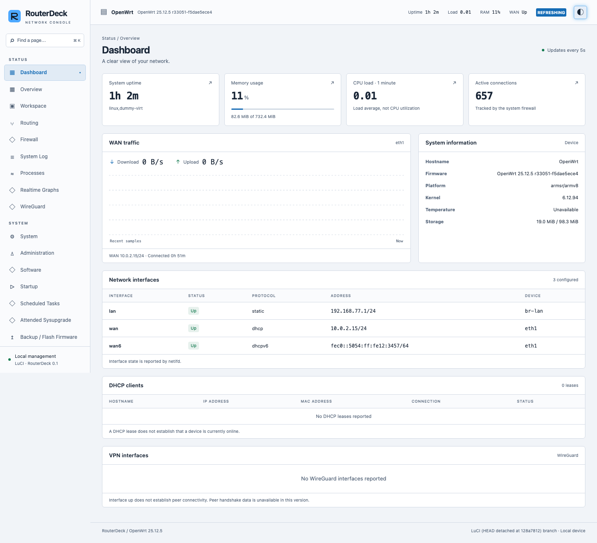
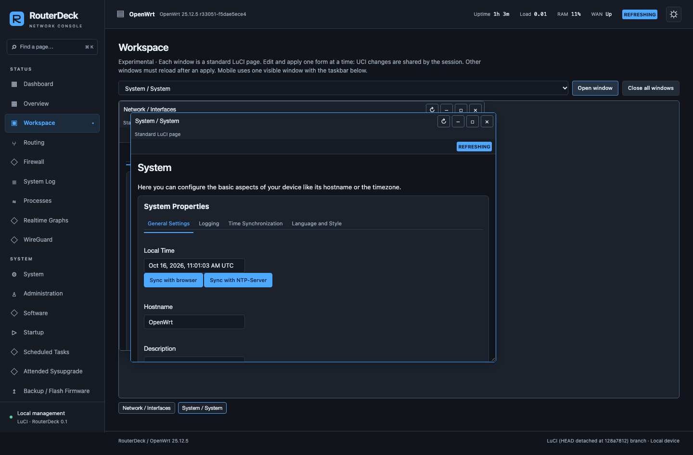

# Validation report — 2026-10-16

RouterDeck 0.1.0 was developed on macOS Apple Silicon and exercised in real,
isolated OpenWrt ARM guests. The local preview is a separate simulated product
surface and is never counted as proof of OpenWrt integration.

## Matrix

| Layer | Coverage |
| --- | --- |
| Unit | 4 checks: rate/reset/missing samples, zero vs unavailable, denied storage, real adapter without WAN |
| Preview | 32 Playwright checks: Chromium and WebKit × 4 viewport sizes × 4 scenarios |
| OpenWrt 25.12.5 | 17 real LuCI checks across both browsers and all viewport sizes |
| OpenWrt 24.10.8 | Same 17 real LuCI checks on a separately booted guest |
| Package lifecycle | One destructive-to-the-guest lifecycle check per firmware version |
| Build | Official 25.12.5 SDK → three APKs; official 24.10.8 SDK → three IPKs |

Viewports: **1920×1080, 1440×900, 1280×800 and 390×844**. Seven duplicate
hostname mutation tests per firmware are intentionally skipped: the guest shares
configuration across browsers, so that write runs once. Window Save & Apply also
runs once per firmware inside its Chromium 1440 scenario.

## What the checks establish

- Preview navigation, dark/light persistence, tables, native preview dialogs,
  validation, mock saving, literal rendering of hostile hostname text, and no
  unexpected JavaScript or console errors.
- Preview workspace keyboard movement/resizing, maximize/restore, minimize,
  task switching, remembered windows, close cancellation and close-all.
- Authenticated real LuCI dashboard data and traffic sampling; the displayed
  platform is the guest's `armsr/armv8`, not the simulated NanoPi fixture.
- Native Interfaces, Firewall, DHCP, System, Backup/Flash and Startup pages;
  interface creation dialog opens and cancels without modifying the network.
- Invalid-password rejection and logout through the original dispatcher.
- Real hostname Save & Apply, UCI persistence, empty pending changes and reload.
  The previous hostname is restored after each test.
- Multiple native LuCI windows retain the authenticated session. An edited form
  cannot close silently; saving another window is blocked. A native form can
  apply successfully inside a window, after which sibling windows require reload.
- Switching to Bootstrap and back through LuCI's Design selector. The dashboard
  also renders under Bootstrap.
- Removing active RouterDeck packages restores Bootstrap, then reinstalling
  registers the theme without silently selecting it. Network, firewall and DHCP
  configuration SHA-256 hashes stay identical across this lifecycle.
- Final package files are real SDK-generated APK/IPK artifacts with dependencies
  and hooks, installed by `apk`/`opkg` in the corresponding guest.

## Visual review

Screenshots are captured in every browser/viewport combination for dark/light,
interfaces, modals and windows. Transitions are finished for screenshots so a
half-faded native LuCI overlay is not mistaken for the final UI. Review caught
and corrected mobile table compression, page overflow, mobile form labels,
save-button contrast and light-mode header contrast.

Representative real guest captures:

The mobile screenshot is [available separately](screenshots/luci-mobile.png).
All shown network addresses belong to disposable QEMU guests.

## Environment and reproducibility

- OpenWrt 25.12.5: ARM `virt`, kernel 6.12.94, LuCI core at `128a7812`.
- OpenWrt 24.10.8: ARM `virt`, kernel 6.6.144, LuCI core at `cac97ed`;
  current standard firewall package from the release feed.
- QEMU HVF on Apple Silicon, two vCPUs, user-mode networking with private guest
  LANs. HTTP/SSH forwarded only to 127.0.0.1.
- SDK/image hashes and exact filenames: `scripts/releases.json`.
- Node.js 22 and locked Playwright 1.64.1. CI runs the preview suite on Linux.
- The VM helper was exercised from a fresh 24.10 image, including provisioning,
  guest package installation, clean stop and restart.

Run commands are in [development.md](development.md). Ignored local evidence is
under `output/playwright/` and `.cache/`; VM traces are disabled to keep login
credentials out of trace artifacts. CI artifacts contain only preview evidence.

## Boundaries and known observations

Assertions cover authenticated views. Initial testing of the stock Bootstrap
JavaScript login view exposed intermittent initialization hangs. RouterDeck now
uses a native HTML form with the same dispatcher login fields. WebKit can also
report a native polling XHR cancellation around iframe lifecycle events; the
test ignores that exact cancellation only during intentional close-all, while
other page errors remain failures. These are not a claim of a universally
error-free browser console or of third-party application compatibility.

No physical NanoPi/FriendlyWrt device, real PPPoE negotiation, WireGuard peer
handshake, hardware sensor, firmware flash or backup restoration was tested.
Workspace is experimental, and custom third-party save controls need separate
validation. See [compatibility.md](compatibility.md) for feature limitations.

The home router, host network interfaces and Mac mini configuration were not
changed. All configuration writes targeted disposable loopback guests.
